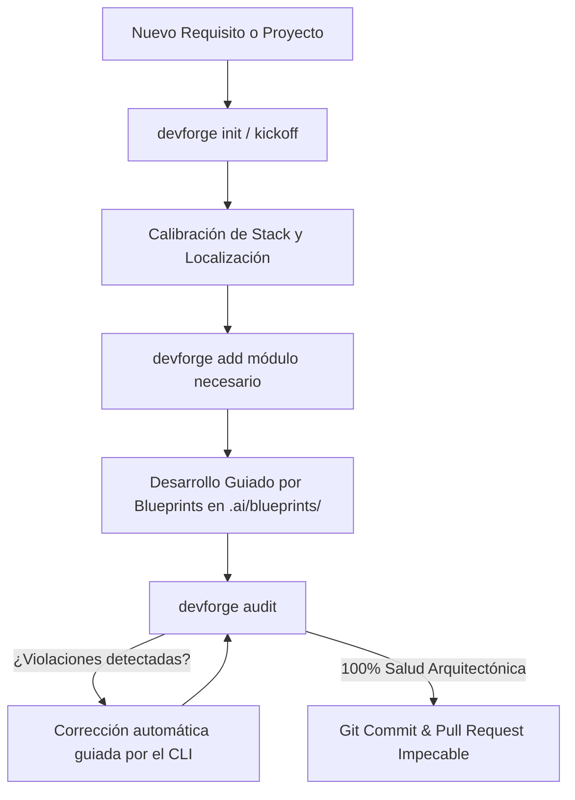

# ⚡ DEVFORGE

> **Protocolo Universal de Arquitectura y Capa de Contexto de IA para Proyectos Empresariales**  
> Compatible con **Google Antigravity**, **Claude Code**, **Cursor**, **OpenAI Codex**, **GitHub Copilot** y cualquier asistente de codificación con IA. Diseñado para aplicaciones de alto rendimiento en **Vue 3**, **React** y ecosistemas fullstack con **TypeScript**.

[](LICENSE)
[](https://nodejs.org/)
[](https://www.typescriptlang.org/)
[](#-filosofía-de-diseño-anti-ai)

---

## 🎯 ¿Qué es DEVFORGE?

**DEVFORGE** es un toolkit integral y una capa de gobernanza de contexto de Inteligencia Artificial que transforma la manera en que los desarrolladores y los agentes de IA colaboran en una base de código.

Los modelos de IA generativa suelen ser inconsistentes: inventan estructuras de carpetas, incrustan listas de datos falsos (*mock data*) directamente en los componentes, usan colores neón poco profesionales, mezclan inglés y español en la interfaz (*Spanglish*) y realizan consultas a bases de datos sin paginación.

**DEVFORGE resuelve esto de raíz proporcionando:**
1. **Un CLI determinista**: Comandos instantáneos para inicializar proyectos (`devforge init`), inyectar módulos de arquitectura (`devforge add <modulo...>`, varios a la vez; no pisa archivos que modificaste salvo con `--force`) y auditar el código fuente en 1 segundo (`devforge audit`).
2. **Capa Multi-Agente Universal**: Archivos de contexto y configuración nativos para Antigravity (`AGENTS.md`, `.agents/skills/`), Claude Code (`CLAUDE.md`, `.claude/commands/`), Cursor (`.cursorrules`) y Copilot (`.github/copilot-instructions.md`).
3. **9 Blueprints de Producción**: Recetas de arquitectura probadas en batalla (OpenAPI SDK, Formularios Zod, Tablas sincronizadas con URL, RBAC CASL, In-App DevTools, Auth Silent Refresh, GraphQL Pagination, Autorizaciones y Notificaciones).
4. **Estándares de Diseño y Gobernanza**: Reglas estrictas de UI/UX Pro Max, paleta «Warm Slate» (grafito en claro, marfil en oscuro), tipografía moderna, formateo localizado de datos y cero Spanglish.
5. **Componentes UI estándar (Vue y React)**: Flickerless en lugar de skeletons, combo `SelectField`, fechas `DateField` / `DateRangeFilter`, paginación `ListPager`, diálogos y avisos, modales, menú de fila, estados de lista, campos de monto y cédula, y avance de lotes, iguales en todos los proyectos.

---

## 📸 Cómo se ve

Capturas reales de los módulos instalados con `devforge add` en un proyecto Vue 3 + Tailwind v4, en tema **Claro** y **Oscuro**. La versión React es idéntica (mismas clases y mismos tokens). Las reglas de uso de cada pieza están en `.ai/standards/ui-components.md`.

### Listado: filtro de período, aviso de cambios, menú de fila y paginación

`DateRangeFilter`, `ListStaleNotice`, `RowMenu`, `ListPager` y Flickerless («—» en lo que aún no se sabe). — `devforge add dates` · `devforge add list-states` · `devforge add overlays` · `devforge add pagination` · `devforge add flickerless`

| Claro | Oscuro |
| :---: | :---: |
|  |  |

### Menú ⋮ de una fila

Vive fuera de la tabla (no se recorta), abre hacia arriba si no cabe y muestra apagada la acción no disponible con su motivo. — `devforge add overlays`

| Claro | Oscuro |
| :---: | :---: |
|  |  |

### Combo `SelectField`

Reemplaza al `<select>` nativo: sigue el tema, no se recorta en modales y se maneja con el teclado. — `devforge add select`

| Claro | Oscuro |
| :---: | :---: |
|  |  |

### Campo de fecha `DateField`

La fecha de un formulario: rótulo dentro del campo, `dd/mm/aaaa`, días pasados apagados con `min` y «Hoy» en la hora de RD. — `devforge add dates`

| Claro | Oscuro |
| :---: | :---: |
|  |  |

### Rango de fechas

«Rango personalizado» del filtro: dos meses lado a lado y previsualización del rango al pasar el cursor. — `devforge add dates`

| Claro | Oscuro |
| :---: | :---: |
|  |  |

### Diálogo del sistema

`confirmDialog()` en lugar de `window.confirm`, aquí encima de un modal: tono destructivo y foco en «Cancelar». Escape cierra solo la capa de arriba. — `devforge add feedback` · `devforge add overlays`

| Claro | Oscuro |
| :---: | :---: |
|  |  |

### Monto, cédula y estado vacío

`MoneyInput` (el valor es un número) y `MaskedInput` (cédula, teléfono, RNC / cédula mientras se escribe); `EmptyState` con su acción. — `devforge add inputs` · `devforge add list-states`

| Claro | Oscuro |
| :---: | :---: |
|  |  |

### Avance de un lote

`BatchProgressModal`: «Procesando 3 de 10…», barra y el resultado de cada registro con su motivo. — `devforge add batch`

| Claro | Oscuro |
| :---: | :---: |
|  |  |

### Autorización: quien pide

El servidor respondió 403 `AUTHORIZATION_REQUIRED`: el modal pide la contraseña propia (o la de otra persona) y el motivo, y la pantalla sigue sola al obtener la llave. — `devforge add authorizations`

| Claro | Oscuro |
| :---: | :---: |
|  |  |

### Autorización: esperando la firma

Solicitud a distancia: la operación continúa sola cuando alguien aprueba. — `devforge add authorizations`

| Claro | Oscuro |
| :---: | :---: |
|  |  |

### Autorización: quien firma

`AuthorizationAlerts`: la tarjeta en vivo con cuenta regresiva, resuelta ahí mismo. — `devforge add authorizations`

| Claro | Oscuro |
| :---: | :---: |
|  |  |

### La campana

`NotificationCenter`: contador real, filtros, agrupada por día en la hora del negocio y avisos de escritorio activados con un clic. — `devforge add notifications`

| Claro | Oscuro |
| :---: | :---: |
|  |  |

---

## 🚨 Los 10 Mandamientos DEVFORGE (Pre-Flight Checklist)

Cada agente de IA que opere en un repositorio configurado con DEVFORGE tiene la obligación contractual de verificar estos 10 puntos antes de generar o editar cualquier archivo:

| # | Mandamiento | Regla Estricta | Alternativa Requerida |
| :-: | :--- | :--- | :--- |
| **1** | **Cero Datos Hardcodeados** | Prohibido declarar `const items = [ ... ]` o arreglos estáticos en componentes (`.vue`, `.tsx`). | Todo dato proviene de `props` tipados, servicios de dominio (`services/`) o composables/hooks asíncronos (`useQuery`). |
| **2** | **Paginación Obligatoria** | Prohibido consultar listas completas sin parámetros de página (`SELECT *` o `GET /items`). | Paginación obligatoria por cursor o desplazamiento (`page`, `pageSize`, `first`, `after`). Cero sobreconsulta. |
| **3** | **Formateo Localizado** | Prohibido imprimir números brutos como moneda (`"$ " + valor`) o fechas ISO (`2026-10-05T15:50:00Z`). | Usar formateadores oficiales: `formatCurrency()`, `formatDate()`, `formatPhoneNumber()`. Fechas en la hora del negocio (nunca `toLocaleDateString()`), moneda del documento (nunca `currency: 'DOP'` en el código). Nulos se renderizan con em-dash `—`. |
| **4** | **Cero Spanglish (100% Español)** | Si la interfaz está en español, prohibida cualquier palabra en inglés en UI, botones o estados. | `Cerrar`, `Guardar`, `Estado`, `Monto`, `Acciones`, `Observado`, `Completado`, `Pendiente`. |
| **5** | **Cero Cyberpunk / Paleta Anti-AI** | Prohibidos los colores cian/teal fluorescentes (`cyan-*`, `#00ff9d`), degradados morados o badges radioactivos. | Paleta «Warm Slate» por tokens (`bg-surface`, `text-foreground`, `border-border`) con badges translúcidos al 10% (`bg-emerald-500/10 text-emerald-700 dark:text-emerald-400`). |
| **6** | **Seguridad Lógica y Tipado** | Prohibido el uso de `any` y mutaciones directas de `props`. | Encadenamiento opcional `record?.cliente?.nombre`, emisión de eventos (`emit`), tipos estrictos y esquemas Zod. |
| **7** | **Tema Claro + Oscuro** | Prohibidas las interfaces de un solo tema y los colores hex dentro de componentes. | Tokens semánticos de `tokens.css` (`bg-surface`, `text-foreground`, `border-border`), `initTheme()` y selector Claro / Oscuro / Sistema. |
| **8** | **Cero Alucinación** | Prohibido inventar funciones, paquetes, endpoints o variables de entorno. | Solo lo que lista `.ai/standards/module-api.md`; si falta, `devforge add <módulo>` o preguntar. |
| **9** | **Componentes UI Estándar** | Prohibidos los skeletons, `animate-pulse`, el `<select>` nativo, `<input type="date">`, `window.confirm/alert/prompt`, modales hechos a mano que se cierran al tocar el telón y pies de paginación propios. | Flickerless, `SelectField`, `DateField` / `DateRangeFilter`, `ListPager`, `confirmDialog()` / `notify()`, `ModalShell` / `DrawerShell` / `RowMenu`, `EmptyState`, `MoneyInput` / `MaskedInput` y `BatchProgressModal` (`.ai/standards/ui-components.md`). |
| **10** | **Autorizaciones y Notificaciones** | Prohibidos los permisos de excepción (`'descuentos:override_tope'`, `canOverrideCredit`), la «contraseña del supervisor» hecha a mano, aplanar los errores del backend a `err.message` y `new Notification()` a mano. | El acto riesgoso va al catálogo de autorizaciones y se avala al consumarlo (blueprint 08, `AuthorizationDialog`); lo persistente va a la campana (`NotificationCenter`, blueprint 09); lo efímero es `notify()`. |

---

## 📦 Estructura que DEVFORGE Despliega en tu Repositorio

Al ejecutar `devforge init`, se inyecta la siguiente infraestructura organizada y estandarizada:

```text
tu-proyecto/
├── .ai/                                  # 🧠 Cerebro y Gobernanza de IA
│   ├── AGENTS.md                         # Contexto para Antigravity, Gemini y Codex
│   ├── CLAUDE.md                         # Contexto para Claude Code
│   ├── .cursorrules                      # Reglas de contexto para Cursor IDE
│   ├── copilot-instructions.md           # Instrucciones para GitHub Copilot
│   ├── blueprints/                       # 📐 9 Blueprints de Arquitectura Empresarial
│   │   ├── 01-openapi-sdk.md             # SDK y hooks tipados desde Swagger/OpenAPI
│   │   ├── 02-schema-forms.md            # Formularios dinámicos con validación Zod
│   │   ├── 03-datagrid-url-sync.md       # Tablas sincronizadas con query params de URL
│   │   ├── 04-rbac-matrix.md             # Matriz de permisos RBAC/ABAC estilo CASL
│   │   ├── 05-in-app-devtools.md         # Cockpit flotante de depuración y simulación
│   │   ├── 06-auth-session.md            # Cola de refresco silencioso de tokens JWT
│   │   ├── 07-graphql-pagination.md      # Paginación estricta y colocación de fragmentos
│   │   ├── 08-authorizations.md          # Autorizaciones: el aval al consumar, nunca un permiso de excepción
│   │   └── 09-notifications.md           # La campana, su bandeja y los avisos de escritorio
│   └── standards/                        # 📋 Estándares de Ingeniería y Diseño
│       ├── project-kickoff.md            # Protocolo de descubrimiento y calibración
│       ├── data-formatting.md            # Moneda, números, fechas, teléfonos y manejo de nulos
│       ├── theming.md                    # Tema claro + oscuro obligatorio con tokens semánticos
│       ├── module-api.md                 # API exacta de cada módulo (evita que la IA invente funciones)
│       ├── ui-components.md              # Flickerless, combo, selector de fechas y paginación
│       ├── ui-ux-principles.md           # Diseño Anti-AI, regla 60-30-10 y espaciado
│       ├── project-structure.md          # Estructura de carpetas guiada por dominio
│       ├── architecture-standards.md     # Capas de servicio, desacoplamiento y paginación
│       └── typescript-rules.md           # Tipos discriminados, inmutabilidad y Zod
├── .claude/commands/                     # ⚡ Slash Commands para Claude Code
│   ├── kickoff.md                        # Comando /kickoff para calibrar el proyecto
│   └── devforge.md                       # Comando /devforge para consultar blueprints
├── .agents/skills/devforge/              # ⚡ Skill Nativo para Google Antigravity
│   └── SKILL.md                          # Protocolo de activación autónoma
├── .github/
│   └── copilot-instructions.md           # Reglas activas para GitHub Copilot
├── AGENTS.md                             # Protocolo raíz para agentes
├── CLAUDE.md                             # Protocolo raíz para Claude
└── .cursorrules                          # Reglas raíz para Cursor
```

---

## 🚀 Instalación y Configuración Inicial

### 1. Clonar y Vincular el CLI Globalmente (Solo una vez en tu máquina)

Para que el comando `devforge` esté disponible en cualquier terminal y en cualquier carpeta de tu equipo:

```bash
# 1. Clona el repositorio si aún no lo tienes
git clone https://github.com/LuisMTaveras/devforge.git
cd devforge/devforge

# 2. Instala dependencias
npm install

# 3. Enlaza el comando globalmente en tu sistema
npm link
```

> **Verificación**: Abre una nueva terminal y ejecuta:
> ```bash
> devforge --help
> ```
> Deberás ver el banner oficial de DEVFORGE con la lista de comandos disponibles.

---

## 🛠️ Cómo Implementar DEVFORGE en CADA Repositorio

### Escenario A: Implementación en un Proyecto Nuevo (Desde Cero / Greenfield)

Cuando vayas a crear una nueva aplicación web o backend:

```bash
# 1. Crea la carpeta de tu nuevo proyecto y navega a ella
mkdir mi-nuevo-proyecto
cd mi-nuevo-proyecto

# 2. Inicializa DEVFORGE en el repositorio
devforge init
```

Una vez ejecutado `devforge init`, la capa de IA ya está activa. Ahora abre tu editor y tu asistente preferido:

1. **En Claude Code o Antigravity**:
   - Ejecuta `/kickoff` (o dile al asistente *"Inicia el kickoff del proyecto con DEVFORGE"*).
2. **¿Qué hará la IA durante el Kickoff?**
   - **Calibración del Desarrollador**: Preguntará tu nivel de experiencia (Junior / Semi-Senior / Senior) para adaptar explicaciones y complejidad técnica.
   - **Asesoramiento de Stack**: Recomendará la mejor combinación tecnológica (Vue 3 + Vite + Tailwind + Pinia o React + Next.js + Zustand + TanStack Query) dándote siempre la decisión final.
   - **Configuración de Localización**: Definirá país, moneda (`DOP`, `USD`, `COP`, `EUR`), separadores de miles y decimales (`1,234.56` vs `1.234,56`), máscara de teléfono (`(809) 578-1234`), formato de fecha y huso horario.
   - **Temas Claro y Oscuro**: Todo proyecto se construye con ambos temas (Claro / Oscuro / Sistema). Solo se elige cuál es el predeterminado.
   - **Delimitación del MVP**: Definirá el alcance funcional mínimo antes de escribir una sola línea de código.
3. **Inyecta los módulos iniciales requeridos**:
   ```bash
   devforge add formatters   # Moneda, números, porcentajes, fechas y teléfonos por país
   devforge add theme        # Tema claro + oscuro (tokens, initTheme, useTheme)
   devforge add auth         # Autenticación segura con cola de refresco
   devforge add rbac         # Permisos por rol y directivas UI
   devforge add dates --vue       # (o --react) Selector de fecha/rango y filtro de período (instala select)
   devforge add pagination --vue  # Pie de paginación estándar (instala flickerless)
   devforge add feedback --vue    # Diálogos del sistema y avisos (confirmDialog, notify)
   devforge add overlays --vue    # ModalShell, DrawerShell y RowMenu
   ```
4. **Comienza a codificar asistido por los blueprints** en `.ai/blueprints/`.
5. **Antes de subir tus cambios a Git, audita tu código**:
   ```bash
   devforge audit
   ```

---

### Escenario B: Implementación en un Proyecto Existente (Brownfield)

Si ya tienes un proyecto en producción o en desarrollo (Vue, React, Next.js, Nuxt, Node.js, etc.):

```bash
# 1. Navega a la raíz de tu proyecto existente
cd d:/Develop/mi-proyecto-existente

# 2. Inyecta DEVFORGE
devforge init
```

**¿Qué ocurre al ejecutar esto?**
- `devforge init` **no sobrescribe** tu código de negocio ni borra tus archivos existentes.
- Inyecta de forma segura los directorios `.ai/`, `.claude/`, `.agents/`, `.github/` y los archivos de contexto raíz (`AGENTS.md`, `CLAUDE.md`, `.cursorrules`).
- Tus asistentes de IA (Antigravity, Cursor, Claude, Copilot) entenderán de inmediato las reglas de calidad del proyecto.

**Siguientes pasos recomendados en proyectos existentes:**
1. **Audita el repositorio para identificar deuda técnica**:
   ```bash
   devforge audit
   ```
   El CLI escaneará tus archivos `.vue`, `.tsx`, `.jsx` y `.ts`, mostrando si tienes datos ficticios quemados en plantillas, palabras en inglés no traducidas o colores neón.
2. **Inyecta utilidades estándar para reemplazar código repetitivo**:
   ```bash
   # Si tu API maneja errores de forma desordenada:
   devforge add errors

   # Si necesitas exportar reportes a Excel/CSV sin problemas de caracteres:
   devforge add export

   # Si necesitas sincronizar tablas con los filtros de la URL:
   devforge add url-sync
   ```

---

## 💻 Referencia Completa de Comandos CLI

El ejecutable `devforge` proporciona los siguientes comandos:

```bash
devforge <comando> [opciones]
```

### 1. `devforge init`
Despliega la capa universal de IA en el repositorio actual:
- Copia las plantillas de agentes (`AGENTS.md`, `CLAUDE.md`, `.cursorrules`, `copilot-instructions.md`).
- Instala los 9 Blueprints en `.ai/blueprints/`.
- Instala las guías de ingeniería y diseño en `.ai/standards/`.
- Configura comandos slash en `.claude/commands/` y el skill en `.agents/skills/`.

### 2. `devforge audit`
Realiza un escaneo estático ultra rápido (en menos de un segundo) sobre todos los archivos del proyecto analizando el cumplimiento de los mandamientos DEVFORGE:
- **Zero Hardcoded Data**: Detecta `const lista = [{ ... }]` quemados dentro de componentes.
- **Anti-AI Cyberpunk Palette**: Detecta colores prohibidos como `cyan-*`, `teal-*`, `#00ff9d`.
- **Zero-Spanglish**: Detecta textos comunes en inglés en botones y estados (`Close`, `Save`, `Status`, `Amount`, `Pending`).
- **Unformatted Currency**: Detecta montos monetarios formateados a mano con `$` en lugar de usar `formatCurrency()`.
- **Componentes estándar**: skeletons y `animate-pulse`, `<select>` nativo, `<input type="date">`, `window.confirm/alert/prompt` y modales que se cierran al tocar el telón (`@click.self`).
- **Moneda escrita a mano**: `currency: 'DOP'` o `=== 'DOP'` en el código (la moneda la trae el documento).
- **Fechas en la zona equivocada**: `toLocaleDateString()`, `toLocaleTimeString()` o `timeZone: 'UTC'` en lugar de `formatDate()` / `formatTime()`.
- **TypeScript apagado**: `// @ts-nocheck` en un archivo completo.
- **Autorizaciones hechas a mano**: permisos de excepción (`'x:override_*'`, `canOverride*`, `bypassLimit`) y contraseñas de supervisor improvisadas.
- **Errores aplanados**: `sendError(res, err.message)` o `.json({ error: err.message })`, que pierden el `code` y los `details` del reto.
- **Notificaciones nativas**: `new Notification()`, `Notification.requestPermission()` o `showNotification` fuera del service worker.
- **Puntuación de Salud Arquitectónica**: Calcula el porcentaje de cumplimiento de 0% a 100%.

Termina con código de salida `1` si hay violaciones, así que sirve para bloquear en CI. En un **proyecto existente**, `devforge audit --baseline` guarda la deuda de hoy en `.devforge-audit-baseline.json` (por archivo y regla); desde ahí la auditoría solo falla con violaciones **nuevas**, y cada arreglo reduce la línea base sola. La deuda solo puede bajar.

### 3. `devforge list`
Muestra en consola el catálogo interactivo de todos los Blueprints, estándares y módulos de código disponibles para consultar o inyectar.

### 4. `devforge add <módulo>`
Inyecta módulos de código limpios, probados y con TypeScript estricto en la estructura de tu proyecto:

| Módulo | Comando | Archivos Generados en tu Proyecto | Propósito |
| :--- | :--- | :--- | :--- |
| **Autenticación** | `devforge add auth` | `src/core/auth/auth-token.ts`<br>`src/core/auth/silent-refresh-queue.ts`<br>`src/modules/auth/stores/auth.store.ts` | Gestión de tokens JWT, almacenamiento seguro y cola anti-colisión para refresco de sesión en peticiones paralelas. |
| **Errores de API** | `devforge add errors` | `src/core/errors/api-error.ts` | Normalizador universal de errores HTTP compatible con Laravel, Express, NestJS, FastAPI y Spring. |
| **Exportación** | `devforge add export` | `src/core/export/export-engine.ts` | Exportación de datos a CSV y Excel con cabecera UTF-8 BOM para soporte total de tildes y caracteres especiales. |
| **Formateadores** | `devforge add formatters` | `src/core/formatters/formatters.ts`<br>`src/core/formatters/input-masks.ts` | Motores de formato localizado por país (República Dominicana por defecto; `setFormatCountry('CO')` para cambiarlo): moneda (`RD$1,500.00`), números con comas y puntos (`1,234,567.89`), porcentajes, fechas relativas, teléfonos (`(809) 578-1234`) y reemplazo de nulos por `—`. |
| **Tema Claro / Oscuro** | `devforge add theme` | `src/core/theme/theme.ts`<br>`src/shared/styles/tokens.css`<br>`src/shared/composables/useTheme.ts` (Vue)<br>`src/shared/hooks/useTheme.ts` (React) | Motor de temas Claro / Oscuro / Sistema con persistencia, tokens semánticos para Tailwind v4 y script anti-parpadeo. |
| **Permisos RBAC** | `devforge add rbac` | `src/core/permissions/ability.ts`<br>`src/shared/components/Can.tsx` (React)<br>`src/shared/directives/v-can.ts` (Vue) | Motor de permisos declarativo basado en habilidades (estilo CASL), directiva `v-can` para Vue 3 y componente `<Can />` para React. |
| **Sincronización URL** | `devforge add url-sync` | `src/core/url-sync/url-state.ts` | Sincronización bidireccional entre estados de filtros/paginación y los `URLSearchParams` del navegador. |
| **Flickerless** | `devforge add flickerless` | `src/shared/flickerless/core/*`<br>`src/shared/flickerless/vue/*`<br>`src/shared/flickerless/react/*`<br>`src/shared/flickerless/flickerless.css` | Reemplazo del skeleton ([github.com/LuisMTaveras/flickerless](https://github.com/LuisMTaveras/flickerless)): lo que estaba se queda atenuado con una barra de 2 px, lo que no se sabe es «—», y la carga en frío pinta la tabla real. |
| **Combo** | `devforge add select` | `src/shared/components/SelectField.vue` (Vue)<br>`src/shared/components/SelectField.tsx` (React) | Desplegable estándar que reemplaza al `<select>` nativo: menú teleportado (no se recorta en modales), tema claro/oscuro, grupos, opciones deshabilitadas y teclado. |
| **Fechas** | `devforge add dates` | `src/core/dates/date-range.ts`<br>`DateField`, `DateRangeFilter`, `DatePicker` (`.vue` / `.tsx`) | `DateField` para la fecha de un formulario, `DateRangeFilter` para el período de un listado (Hoy, Ayer, Este mes…, flechas de día y rango personalizado) y `DatePicker range` para un rango suelto. El valor es la clave `'2026-10-15'`; «Hoy» se calcula en la zona de RD. |
| **Diálogos y avisos** | `devforge add feedback` | `src/core/feedback/dialog.ts`<br>`src/core/feedback/toast.ts`<br>`ConfirmDialog` y `ToastHost` (`.vue` / `.tsx`) | `confirmDialog()`, `alertDialog()`, `promptDialog()` y `notify()`: el diálogo del sistema que reemplaza a `window.confirm`, con tono destructivo, Escape y Enter. |
| **Modales** | `devforge add overlays` | `src/core/overlay/*.ts`<br>`ModalShell`, `DrawerShell`, `RowMenu` (`.vue` / `.tsx`)<br>`useOverlay` | Armazón de modal y panel lateral (el telón no cierra, Escape cierra la capa de arriba, fondo sin scroll) y menú «⋮» de fila que no se recorta. |
| **Estados de lista** | `devforge add list-states` | `EmptyState`, `ListStaleNotice` (`.vue` / `.tsx`) | Lista vacía con acción directa y aviso de cambios nuevos sin recargar sola. |
| **Campos** | `devforge add inputs` | `src/core/formatters/input-masks.ts`<br>`MoneyInput`, `MaskedInput` (`.vue` / `.tsx`) | Monto con los separadores del país (valor numérico) y cédula `001-1234567-8`, RNC `1-01-23456-7` y teléfono `(809) 578-1234` mientras se escribe. |
| **Lotes** | `devforge add batch` | `src/core/batch/batch-progress.ts`<br>`BatchProgressModal` (`.vue` / `.tsx`) | Avance en vivo de un proceso uno a uno: «Procesando 3 de 10…», barra y resultado de cada registro. |
| **Autorizaciones** | `devforge add authorizations` | `src/core/authorizations/authorization.ts`<br>`AuthorizationDialog`, `AuthorizationAlerts` (`.vue` / `.tsx`) | El interceptor reconoce el 403 `AUTHORIZATION_REQUIRED`, abre el modal (mi contraseña, credenciales de otro o solicitud a distancia) y reintenta la misma petición con la llave. Quien firma recibe una tarjeta en vivo con cuenta regresiva. El backend es el blueprint 08. |
| **Notificaciones** | `devforge add notifications` | `src/core/notifications/notifications.ts`<br>`NotificationCenter` (`.vue` / `.tsx`) | La campana: contador real, filtros, agrupada por día en la hora del negocio, acuse reversible y avisos de escritorio activados con un clic. El backend es el blueprint 09. |
| **Paginación** | `devforge add pagination` | `src/core/pagination/pagination.ts`<br>`src/shared/components/ListPager.vue`<br>`ListPager.tsx` (React) | Pie de listado estándar: «Mostrando 11–20 de 57 facturas» y ‹ 2 / 6 ›, con «—» hasta la primera respuesta. |

---

## 📐 Los 9 Blueprints de Arquitectura Empresarial

Ubicados en `.ai/blueprints/`, estos documentos son recetas canónicas que instruyen a tu IA exactamente sobre cómo estructurar patrones complejos:

1. **`01-openapi-sdk.md` (OpenAPI/Swagger a SDK Tipado)**:
   - Elimina la escritura manual de interfaces TypeScript y llamadas `fetch`/`axios` sueltas.
   - Genera clientes de API 100% tipados y hooks/composables de TanStack Query o Vue automáticamente desde el JSON del Swagger.

2. **`02-schema-forms.md` (Formularios Dinámicos con Esquemas Zod)**:
   - Elimina el código repetitivo en formularios. Define un único esquema de **Zod** y renderiza dinámicamente campos accesibles, selects, switches, validaciones reactivas y mensajes de error.

3. **`03-datagrid-url-sync.md` (Tablas de Datos + Sincronización con URL)**:
   - Conecta tablas (TanStack Table o componentes de datos) con la barra de direcciones (`?page=2&search=acme&sort=-fecha&estado=activo`). Permite compartir URLs con filtros exactos y soporta el historial del navegador (*atrás/adelante*).

4. **`04-rbac-matrix.md` (Control de Acceso Declarativo RBAC / ABAC)**:
   - Elimina condicionales caóticos como `if (user.role === 'admin' || user.permisos.includes('editar'))`. Implementa verificación declarativa:
     - En React: `<Can I="update" an="Invoice">...</Can>`
     - En Vue: `<button v-can="['update', 'Invoice']">Guardar</button>`

5. **`05-in-app-devtools.md` (Cockpit Flotante de Depuración)**:
   - Barra de herramientas flotante exclusiva de entorno de desarrollo (`NODE_ENV === 'development'`) que permite al equipo cambiar de rol en un clic, simular latencia de red 3G/4G e inyectar errores 401 o 500 para probar la resiliencia de la app.

6. **`06-auth-session.md` (Sesión Empresarial y Cola de Refresco Silencioso)**:
   - Soluciona el problema de condición de carrera (*race condition*) cuando expira el token de acceso y 5 peticiones paralelas reciben un `401 Unauthorized`. Las encola detrás de una sola solicitud de refresco sin cerrar la sesión del usuario.

7. **`07-graphql-pagination.md` (Paginación Estricta y Optimización GraphQL)**:
   - Asegura paginación obligatoria basada en cursores o desplazamiento, colocación de fragmentos por componente y cero sobreconsulta de campos a la base de datos.
8. **`08-authorizations.md` (Autorizaciones)**:
   - Un permiso dice qué pantalla se puede tocar; una autorización dice si ESTE acto, con ESTE importe, puede consumarse. Catálogo de actos (todo nace apagado), política por empresa, autorizadores con tope, huella del acto, llave de un solo uso, el importe como techo, `liftsBlock` para excepciones a un muro existente, el contrato del 403 y los trinquetes. El dueño y el ADMIN siempre pueden avalar.
9. **`09-notifications.md` (Notificaciones)**:
   - Cuándo es diálogo, toast, notificación o tarjeta de autorización; modelo y API de la bandeja con aislamiento por usuario y empresa; cómo se emite un aviso (categoría, enlace sin prefijo, a quién); avisos de escritorio y web push.

---

## 🎨 Filosofía de Diseño Anti-AI (UI/UX Pro Max)

DEVFORGE destierra la estética predecible y sobrecargada que suelen generar los modelos de IA, aplicando principios visuales de nivel enterprise (inspirados en Linear, Stripe y Vercel):

### 1. Regla de Color 60-30-10
- **60% Superficie Neutra**: Paleta «Warm Slate» heredada de Snowlr: grafito en Claro y marfil en Oscuro, en OKLCH, siempre por tokens (`bg-background`, `bg-surface`, `bg-surface-raised`, `border-border`).
- **30% Jerarquía Tipográfica**: `text-foreground`, `text-muted-foreground`, `text-dim-foreground`, con la escala cerrada `text-caption` · `text-small` · `text-body` · `text-title`.
- **10% Acento Funcional**: Color de acción enfocado exclusivamente en llamadas a la acción primarias (CTA) e indicadores de estado.

### 2. Badges Suaves (Soft-Tint Badges)
- **Prohibido**: Píldoras con colores fluorescentes y fondos opacos agresivos.
- **Obligatorio**: Fondos translúcidos con opacidad reducida y bordes sutiles:
  ```html
  <!-- Ejemplo: Estado exitoso/completado -->
  <span class="bg-emerald-500/10 text-emerald-400 border border-emerald-500/20 px-2.5 py-0.5 rounded-full text-xs font-medium">
    Completado
  </span>
  ```

### 3. Componentes Estándar (Vue y React)
Las mismas piezas en todos los proyectos, instaladas con `devforge add` (reglas en `.ai/standards/ui-components.md`):
- **Carga sin skeleton (Flickerless)**: lo que ya estaba se queda atenuado bajo una barra de 2 px; lo que aún no se sabe es «—» (nunca `RD$0.00` mientras carga); la primera carga pinta la tabla real con `FlickerlessTableShell`.
- **Combo `SelectField`**: reemplaza al `<select>` nativo; el menú no se recorta en modales y sigue el tema.
- **Fechas**: `DateField` es el campo de fecha de los formularios; `DateRangeFilter`, el filtro de período de los listados (Hoy, Ayer, Este mes…, flechas de día y rango personalizado); `DatePicker range`, un rango suelto. El valor es la clave `'2026-10-15'`, se envía tal cual a la API, se muestra `dd/mm/aaaa` y «Hoy» se calcula en la hora de RD. Guía: `.ai/standards/ui-components.md` §3.
- **Paginación `ListPager`**: «Mostrando 11–20 de 57 facturas» y ‹ 2 / 6 ›.
- **Diálogos y avisos (`feedback`)**: `confirmDialog()`, `alertDialog()` y `promptDialog()` en lugar de `window.confirm`, con tono destructivo (`tone: 'danger'`) para lo que no se deshace; `notify()` para lo que no interrumpe.
- **Modales (`overlays`)**: `ModalShell` y `DrawerShell` no se cierran al tocar el telón, Escape cierra solo la capa de arriba y el fondo no se desplaza. `RowMenu` es el menú «⋮» de las filas, con las acciones no disponibles apagadas y su motivo.
- **Estados de lista (`list-states`)**: `EmptyState` (icono, titular, explicación y acción) y `ListStaleNotice` («Hay cambios nuevos · Actualizar lista», sin recargar sola).
- **Campos (`inputs`)**: `MoneyInput` (el valor es un número, nunca texto) y `MaskedInput` para cédula, RNC y teléfono enmascarados mientras se escribe.
- **Lotes (`batch`)**: `BatchProgressModal` muestra «Procesando 3 de 10…» y el resultado de cada registro (listo, omitido o error y por qué).

```vue
<!-- Vue -->
<DateRangeFilter v-model="periodo" @change="cargar" />
<FlickerlessSurface :loading="loading">
  <table>…</table>
  <ListPager v-model:page="page" :page-size="20" :total="meta?.total" singular="factura" plural="facturas" />
</FlickerlessSurface>
```

```tsx
// React
<DateRangeFilter value={periodo} onChange={setPeriodo} onCommit={cargar} />
<FlickerlessSurface loading={isFetching}>
  <table>…</table>
  <ListPager page={page} onPageChange={setPage} pageSize={20} total={data?.meta.total} singular="factura" plural="facturas" />
</FlickerlessSurface>
```

### 4. Cero Spanglish en la Interfaz
Toda aplicación en español debe mantener consistencia lingüística absoluta:
- `Close` ➔ **Cerrar**
- `Save` ➔ **Guardar**
- `Status` ➔ **Estado**
- `Amount` ➔ **Monto**
- `Actions` ➔ **Acciones**
- `Pending` ➔ **Pendiente**
- `Settled` ➔ **Completado**
- `Flagged` ➔ **Observado**
- `Reversed` ➔ **Revertido**

---

## 🤖 Compatibilidad Multi-Asistente de IA

DEVFORGE funciona de forma nativa e integrada con los principales entornos y asistentes de IA del mercado:

| Asistente de IA | Archivo de Contexto Utilizado | Características Nativas |
| :--- | :--- | :--- |
| **Google Antigravity** | `AGENTS.md` y `.agents/skills/devforge/` | Activación automática de la skill `devforge`, verificación del pre-flight checklist y ejecución de blueprints. |
| **Claude Code** | `CLAUDE.md` y `.claude/commands/` | Slash commands nativos en terminal: `/kickoff` (descubrimiento inicial) y `/devforge` (asistente de blueprints). |
| **Cursor IDE** | `.cursorrules` y `.ai/` | Carga contextual permanente de reglas de arquitectura en chats y autocompletado en el editor. |
| **GitHub Copilot** | `.github/copilot-instructions.md` | Instrucciones de repositorio compartidas para agentes de Copilot y pull requests. |
| **OpenAI Codex / ChatGPT** | `AGENTS.md` | Protocolo universal de instrucciones de sistema y restricciones de diseño. |

---

## 🛡️ Cómo Evita DEVFORGE que la IA Alucine

Las instrucciones (`CLAUDE.md`, `AGENTS.md`, `.cursorrules`, Copilot) incluyen el punto **ZERO HALLUCINATION** y un **orden de verdad** para cuando las fuentes no coinciden:

1. Lo que el usuario pide explícitamente en la conversación.
2. El código instalado en el proyecto (`src/`, `package.json`).
3. `.ai/standards/module-api.md`: la lista **exacta** de funciones de cada módulo. Si algo no está ahí, no existe.
4. Los estándares de `.ai/standards/`.
5. Los blueprints de `.ai/blueprints/`, que son patrones de referencia que se adaptan, no se copian a ciegas.

Además, la IA tiene prohibido inventar paquetes, endpoints, campos de GraphQL o variables de entorno. Antes debe leer `package.json`, `v1.d.ts` y `.env.example`, y si algo no está, preguntar.

> ⚠️ Usa siempre el comando `devforge` enlazado con `npm link`. **No uses `npx devforge`**: en npm existe otro paquete con ese nombre que no tiene relación con este proyecto.

---

## 🏗️ Estructura de Código Recomendada para tus Proyectos

Cuando desarrolles una aplicación con DEVFORGE, la estructura de carpetas en `src/` seguirá el estándar de Arquitectura Orientada a Dominios:

```text
src/
├── app/                        # Configuración global, router, proveedores y layout raíz
├── core/                       # Utilidades agnósticas, formatters, clientes HTTP y motores
│   ├── auth/                   # Cola de refresco silencioso y tokens
│   ├── errors/                 # Normalizador de errores de API
│   ├── export/                 # Motores de exportación a CSV/Excel
│   ├── formatters/             # Formato localizado de moneda, números, fechas y teléfonos
│   ├── permissions/            # Motor de habilidades RBAC (Ability)
│   ├── theme/                  # Motor de tema claro / oscuro
│   └── url-sync/               # Sincronizador de parámetros de URL
├── modules/                    # Dominios de negocio independientes (Modular)
│   └── [modulo]/               # Ej: clientes, facturas, productos
│       ├── components/         # Componentes específicos del dominio
│       ├── composables/        # Hooks (React) o Composables (Vue)
│       ├── services/           # Capa de consumo de API (sin llamadas directas en componentes)
│       ├── types/              # Contratos TypeScript y esquemas Zod
│       └── index.ts            # Punto de exportación pública del módulo
└── shared/                     # Primitivas reutilizables de UI (Botones, Modales, Tablas)
```

---

## 🔄 Flujo de Trabajo Recomendado en el Día a Día



1. **Paso 1**: Inicializa el repo con `devforge init`.
2. **Paso 2**: Calibra el proyecto con tu IA usando `/kickoff`.
3. **Paso 3**: Inyecta las piezas base con `devforge add <modulo>`.
4. **Paso 4**: Construye interfaces y servicios con asistencia de la IA siguiendo los Blueprints.
5. **Paso 5**: Ejecuta `devforge audit` antes de realizar cada commit para garantizar que no existan datos quemados, Spanglish ni colores neón.

---

## 📄 Licencia

Este proyecto está distribuido bajo la licencia **MIT**. Consulta el archivo `LICENSE` para más detalles.

---

<div align="center">
  <sub>Construido con precisión artesanal por el equipo de <b>DEVFORGE</b>. Diseñado para elevar la ingeniería de software asistida por IA.</sub>
</div>
