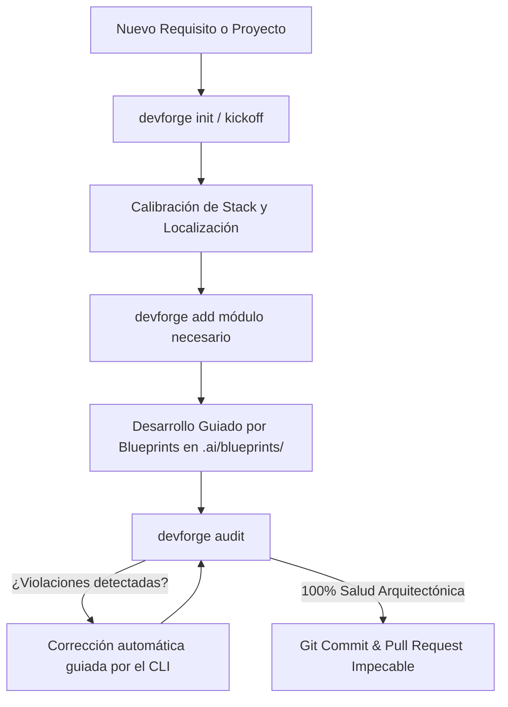

# ⚡ DEVFORGE

> **Protocolo Universal de Arquitectura y Capa de Contexto de IA para Proyectos Empresariales**  
> Compatible con **Google Antigravity**, **Claude Code**, **Cursor**, **OpenAI Codex**, **GitHub Copilot** y cualquier asistente de codificación con IA. Diseñado para aplicaciones de alto rendimiento en **Vue 3**, **React** y ecosistemas fullstack con **TypeScript**.

[](LICENSE)
[](https://nodejs.org/)
[](https://www.typescriptlang.org/)
[](#-filosofía-de-diseño-anti-ai)

---

## 🎯 ¿Qué es DEVFORGE?

**DEVFORGE** es un toolkit integral y una capa de gobernanza de contexto de Inteligencia Artificial que transforma la manera en que los desarrolladores y los agentes de IA colaboran en una base de código.

Los modelos de IA generativa suelen ser inconsistentes: inventan estructuras de carpetas, incrustan listas de datos falsos (*mock data*) directamente en los componentes, usan colores neón poco profesionales, mezclan inglés y español en la interfaz (*Spanglish*) y realizan consultas a bases de datos sin paginación.

**DEVFORGE resuelve esto de raíz proporcionando:**
1. **Un CLI determinista**: inicializa proyectos sin borrar lo que ya tenían (`devforge init`), instala módulos detectando el framework (`devforge add <módulo…>`; nunca pisa lo que editaste), dice qué está instalado y qué falta conectar (`devforge status`), actualiza (`devforge update`) y audita el código en un segundo (`devforge audit`).
2. **Capa Multi-Agente Universal**: Archivos de contexto y configuración nativos para Antigravity (`AGENTS.md`, `.agents/skills/`), Claude Code (`CLAUDE.md`, `.claude/commands/`), Cursor (`.cursorrules`) y Copilot (`.github/copilot-instructions.md`).
3. **16 Blueprints de Producción**: Recetas de arquitectura probadas en batalla (OpenAPI SDK, formularios Zod, tablas sincronizadas con la URL, RBAC, DevTools, sesión con refresco silencioso, paginación GraphQL, autorizaciones, notificaciones, reportes Excel, historial y entrega de documentos, límites de peticiones, idempotencia, sesiones y sockets).
4. **Estándares de Diseño y Gobernanza**: Reglas estrictas de UI/UX Pro Max, paleta «Warm Slate» (grafito en claro, marfil en oscuro), tipografía moderna, formateo localizado de datos y cero Spanglish.
5. **Componentes UI estándar (Vue, React y Android / Jetpack Compose)**: Flickerless en lugar de skeletons, combo `SelectField`, fechas `DateField` / `DateRangeFilter`, paginación `ListPager`, diálogos y avisos, modales, menú de fila, estados de lista, campos de monto y cédula, y avance de lotes, iguales en todos los proyectos.

---

## ⚡ Inicio rápido

```bash
# Una vez en tu máquina
git clone https://github.com/LuisMTaveras/devforge.git && cd devforge/devforge
pnpm install && pnpm link --global          # el comando `devforge` (nunca npx devforge: es otro paquete)

# En cada proyecto
cd ~/mi-proyecto
devforge init                                # contexto para agentes; no borra tu CLAUDE.md
devforge add formatters theme errors feedback overlays flickerless list-states   # la base (detecta Vue, React o Android)
devforge status                              # qué está instalado y qué falta conectar
devforge audit                               # las reglas, en un segundo (código 1 si algo falla)
```

Después, en tu agente: **`/kickoff`** para un proyecto nuevo, **`/devforge`** para consultar los blueprints y estándares. Los detalles de cada paso están más abajo, en [Instalación](#-instalación-y-configuración-inicial) y en la [referencia de comandos](#-referencia-completa-de-comandos-cli).

---

## 📸 Cómo se ve

Capturas reales de cada módulo en tema **Claro** y **Oscuro** (Vue 3 + Tailwind v4; React es idéntico): **[docs/galeria.md](docs/galeria.md)**.

| Claro | Oscuro |
| :---: | :---: |
|  |  |

---

## 🚨 Los 11 Mandamientos DEVFORGE (Pre-Flight Checklist)

Cada agente de IA que opere en un repositorio configurado con DEVFORGE tiene la obligación de verificar estos 11 puntos antes de generar o editar cualquier archivo, y de cerrar cada tarea con el 11:

| # | Mandamiento | Regla Estricta | Alternativa Requerida |
| :-: | :--- | :--- | :--- |
| **1** | **Cero Datos Hardcodeados** | Prohibido declarar `const items = [ ... ]` o arreglos estáticos en componentes (`.vue`, `.tsx`). | Todo dato proviene de `props` tipados, servicios de dominio (`services/`) o composables/hooks asíncronos (`useQuery`). |
| **2** | **Paginación Obligatoria** | Prohibido consultar listas completas sin parámetros de página (`SELECT *` o `GET /items`). | Paginación obligatoria por cursor o desplazamiento (`page`, `pageSize`, `first`, `after`). Cero sobreconsulta. |
| **3** | **Formateo Localizado** | Prohibido imprimir números brutos como moneda (`"$ " + valor`) o fechas ISO (`2026-10-05T15:50:00Z`). | Usar formateadores oficiales: `formatCurrency()`, `formatDate()`, `formatPhoneNumber()`. Fechas en la hora del negocio (nunca `toLocaleDateString()`), moneda del documento (nunca `currency: 'DOP'` en el código). Nulos se renderizan con em-dash `—`. |
| **4** | **Cero Spanglish (100% Español)** | Si la interfaz está en español, prohibida cualquier palabra en inglés en UI, botones o estados. | `Cerrar`, `Guardar`, `Estado`, `Monto`, `Acciones`, `Observado`, `Completado`, `Pendiente`. |
| **5** | **Cero Cyberpunk / Paleta Anti-AI** | Prohibidos los colores cian/teal fluorescentes (`cyan-*`, `#00ff9d`), degradados morados o badges radioactivos. | Paleta «Warm Slate» por tokens (`bg-surface`, `text-foreground`, `border-border`) con badges translúcidos al 10% por tokens (`border-success/20 bg-success/10 text-success`). Un solo color de acción: `primary`. |
| **6** | **Seguridad Lógica y Tipado** | Prohibidos `any`, `@ts-ignore` y las mutaciones directas de `props`. | `?.` donde el tipo puede ser nulo, eventos (`emit` / `onChange`), Zod en las fronteras y los tres desenlaces de toda acción (en curso, éxito, error con `normalizeApiError`). |
| **7** | **Tema Claro + Oscuro** | Prohibidas las interfaces de un solo tema y los colores hex dentro de componentes. | Tokens semánticos de `tokens.css` (`bg-surface`, `text-foreground`, `border-border`), `initTheme()` y selector Claro / Oscuro / Sistema. |
| **8** | **Cero Alucinación** | Prohibido inventar funciones, paquetes, endpoints o variables de entorno. | Solo lo que lista `.ai/standards/module-api.md`; si falta, `devforge add <módulo>` o preguntar. |
| **9** | **Componentes UI Estándar** | Prohibidos los skeletons, `animate-pulse`, el `<select>` nativo, `<input type="date">`, `window.confirm/alert/prompt`, modales hechos a mano que se cierran al tocar el telón y pies de paginación propios. | Flickerless, `SelectField`, `DateField` / `DateRangeFilter`, `ListPager`, `confirmDialog()` / `notify()`, `ModalShell` / `DrawerShell` / `RowMenu`, `EmptyState`, `MoneyInput` / `MaskedInput` `BatchProgressModal`, `TableStates`, `ListToolbar`, `downloadExcelReport()`, `RecordPickerModal`, `DocumentPreviewModal` y `escapeHtml` / `safeLinkUrl` para datos de terceros (`.ai/standards/ui-components.md`). |
| **10** | **Autorizaciones y Notificaciones** | Prohibidos los permisos de excepción (`'descuentos:override_tope'`, `canOverrideCredit`), la «contraseña del supervisor» hecha a mano, aplanar los errores del backend a `err.message` y `new Notification()` a mano. | El acto riesgoso va al catálogo de autorizaciones y se avala al consumarlo (blueprint 08, `AuthorizationDialog`); lo persistente va a la campana (`NotificationCenter`, blueprint 09); lo efímero es `notify()`. |
| **11** | **Definición de Terminado** | Prohibido decir «listo» sin haberlo corrido. | Typecheck, build y tests con su salida real; `devforge audit` sin violaciones nuevas; Claro y Oscuro, 375 px, solo teclado y los cuatro estados de datos (primera carga, con datos, vacío, error). Lo que no se pudo verificar se dice. |

---

## 📦 Estructura que DEVFORGE Despliega en tu Repositorio

Al ejecutar `devforge init`, se inyecta la siguiente infraestructura organizada y estandarizada:

```text
tu-proyecto/
├── .ai/                                  # 🧠 Cerebro y Gobernanza de IA
│   ├── AGENTS.md                         # Contexto para Antigravity, Gemini y Codex
│   ├── CLAUDE.md                         # Contexto para Claude Code
│   ├── .cursorrules                      # Reglas de contexto para Cursor IDE
│   ├── copilot-instructions.md           # Instrucciones para GitHub Copilot
│   ├── blueprints/                       # 📐 16 Blueprints de Arquitectura Empresarial
│   │   ├── 01-openapi-sdk.md             # SDK y hooks tipados desde Swagger/OpenAPI
│   │   ├── 02-schema-forms.md            # Formularios dinámicos con validación Zod
│   │   ├── 03-datagrid-url-sync.md       # Tablas sincronizadas con query params de URL
│   │   ├── 04-rbac-matrix.md             # Matriz de permisos RBAC/ABAC estilo CASL
│   │   ├── 05-in-app-devtools.md         # Cockpit flotante de depuración y simulación
│   │   ├── 06-auth-session.md            # Cola de refresco silencioso de tokens JWT
│   │   ├── 07-graphql-pagination.md      # Paginación estricta y colocación de fragmentos
│   │   ├── 08-authorizations.md          # Autorizaciones: el aval al consumar, nunca un permiso de excepción
│   │   └── 09-notifications.md           # La campana, su bandeja y los avisos de escritorio
│   └── standards/                        # 📋 Estándares de Ingeniería y Diseño
│       ├── project-kickoff.md            # Protocolo de descubrimiento y calibración
│       ├── data-formatting.md            # Moneda, números, fechas, teléfonos y manejo de nulos
│       ├── theming.md                    # Tema claro + oscuro obligatorio con tokens semánticos
│       ├── module-api.md                 # API exacta de cada módulo (evita que la IA invente funciones)
│       ├── ui-components.md              # Flickerless, combo, selector de fechas y paginación
│       ├── ui-ux-principles.md           # Diseño Anti-AI, regla 60-30-10 y espaciado
│       ├── project-structure.md          # Estructura de carpetas guiada por dominio
│       ├── architecture-standards.md     # Capas de servicio, desacoplamiento y paginación
│       └── typescript-rules.md           # Tipos discriminados, inmutabilidad y Zod
├── .claude/commands/                     # ⚡ Slash Commands para Claude Code
│   ├── kickoff.md                        # Comando /kickoff para calibrar el proyecto
│   └── devforge.md                       # Comando /devforge para consultar blueprints
├── .agents/skills/devforge/              # ⚡ Skill Nativo para Google Antigravity
│   └── SKILL.md                          # Protocolo de activación autónoma
├── .github/
│   └── copilot-instructions.md           # Reglas activas para GitHub Copilot
├── AGENTS.md                             # Protocolo raíz para agentes
├── CLAUDE.md                             # Protocolo raíz para Claude
└── .cursorrules                          # Reglas raíz para Cursor
```

---

## 🚀 Instalación y Configuración Inicial

### 1. Clonar y Vincular el CLI Globalmente (Solo una vez en tu máquina)

Para que el comando `devforge` esté disponible en cualquier terminal y en cualquier carpeta de tu equipo:

```bash
# 1. Clona el repositorio si aún no lo tienes
git clone https://github.com/LuisMTaveras/devforge.git
cd devforge/devforge

# 2. Instala dependencias (pnpm; si no lo tienes: corepack enable)
pnpm install

# 3. Enlaza el comando globalmente en tu sistema
#    (la primera vez, `pnpm setup` crea la carpeta global y te pide abrir otra terminal)
pnpm link --global
```

> **Verificación**: Abre una nueva terminal y ejecuta:
> ```bash
> devforge --help
> ```
> Deberás ver el banner oficial de DEVFORGE con la lista de comandos disponibles.

---

## 🛠️ Cómo Implementar DEVFORGE en CADA Repositorio

### Escenario A: Implementación en un Proyecto Nuevo (Desde Cero / Greenfield)

Cuando vayas a crear una nueva aplicación web o backend:

```bash
# 1. Crea la carpeta de tu nuevo proyecto y navega a ella
mkdir mi-nuevo-proyecto
cd mi-nuevo-proyecto

# 2. Inicializa DEVFORGE en el repositorio
devforge init
```

Una vez ejecutado `devforge init`, la capa de IA ya está activa. Ahora abre tu editor y tu asistente preferido:

1. **En Claude Code o Antigravity**:
   - Ejecuta `/kickoff` (o dile al asistente *"Inicia el kickoff del proyecto con DEVFORGE"*).
2. **¿Qué hará la IA durante el Kickoff?**
   - **Calibración del Desarrollador**: Preguntará tu nivel de experiencia (Junior / Semi-Senior / Senior) para adaptar explicaciones y complejidad técnica.
   - **Asesoramiento de Stack**: Recomendará la mejor combinación tecnológica (Vue 3 + Vite + Tailwind + Pinia o React + Next.js + Zustand + TanStack Query) dándote siempre la decisión final.
   - **Configuración de Localización**: Definirá país, moneda (`DOP`, `USD`, `COP`, `EUR`), separadores de miles y decimales (`1,234.56` vs `1.234,56`), máscara de teléfono (`(809) 578-1234`), formato de fecha y huso horario.
   - **Temas Claro y Oscuro**: Todo proyecto se construye con ambos temas (Claro / Oscuro / Sistema). Solo se elige cuál es el predeterminado.
   - **Delimitación del MVP**: Definirá el alcance funcional mínimo antes de escribir una sola línea de código.
3. **Inyecta los módulos iniciales requeridos**:
   ```bash
   # El framework (Vue, React o Android) se detecta solo
   devforge add formatters theme errors feedback overlays flickerless list-states   # la base de toda pantalla
   devforge add dates pagination select   # período, paginación y combo (lo que use la primera pantalla)
   devforge add auth rbac                 # sesión con refresco silencioso y permisos
   devforge status                        # confirma que está instalado y qué falta conectar
   ```
4. **Comienza a codificar asistido por los blueprints** en `.ai/blueprints/`.
5. **Antes de subir tus cambios a Git, audita tu código**:
   ```bash
   devforge audit
   ```

---

### Escenario B: Implementación en un Proyecto Existente (Brownfield)

Si ya tienes un proyecto en producción o en desarrollo (Vue, React, Next.js, Nuxt, Node.js, etc.):

```bash
# 1. Navega a la raíz de tu proyecto existente
cd d:/Develop/mi-proyecto-existente

# 2. Inyecta DEVFORGE
devforge init
```

**¿Qué ocurre al ejecutar esto?**
- `devforge init` **no borra nada tuyo**: si ya tienes `CLAUDE.md`, `AGENTS.md`, `.cursorrules` o `.github/copilot-instructions.md`, los conserva y les añade el bloque de DEVFORGE al final (entre `<!-- devforge:start -->` y `<!-- devforge:end -->`).
- Crea `.ai/`, `.claude/commands/`, `.agents/skills/` y `.devforge/manifest.json` (el registro de lo instalado; súbelo al repositorio).
- Tus asistentes de IA (Antigravity, Cursor, Claude, Copilot) entenderán de inmediato las reglas de calidad del proyecto.

**Siguientes pasos recomendados en proyectos existentes:**
1. **Audita el repositorio para identificar deuda técnica**:
   ```bash
   devforge audit
   ```
   El CLI escaneará tus archivos `.vue`, `.tsx`, `.jsx`, `.ts` y `.kt` (sin pruebas ni lo que ignora `.gitignore`), mostrando si tienes datos ficticios quemados en plantillas, palabras en inglés no traducidas o colores neón. Para adoptar DEVFORGE sin arreglarlo todo de golpe: `devforge audit --baseline`.
2. **Inyecta utilidades estándar para reemplazar código repetitivo**:
   ```bash
   # Si tu API maneja errores de forma desordenada:
   devforge add errors

   # Si necesitas exportar reportes a Excel/CSV sin problemas de caracteres:
   devforge add export

   # Si necesitas sincronizar tablas con los filtros de la URL:
   devforge add url-sync
   ```

---

## 💻 Referencia Completa de Comandos CLI

El ejecutable `devforge` proporciona los siguientes comandos:

```bash
devforge <comando> [opciones]
```

### 1. `devforge init`
Despliega la capa universal de IA en el repositorio actual:
- Instala las instrucciones de los agentes (`AGENTS.md`, `CLAUDE.md`, `.cursorrules`, `.github/copilot-instructions.md`). **Si ya tenías alguno, no se borra**: DEVFORGE añade su bloque al final, entre `<!-- devforge:start -->` y `<!-- devforge:end -->`, y en adelante solo actualiza ese bloque.
- Instala los 16 blueprints en `.ai/blueprints/`, los estándares en `.ai/standards/` y una copia de referencia de las instrucciones en `.ai/`.
- Configura los comandos `/kickoff` y `/devforge` en `.claude/commands/` y el skill en `.agents/skills/`.
- Se puede volver a correr: actualiza lo que no editaste. Un `CLAUDE.md` de una versión anterior de DEVFORGE que editaste se conserva; `--force` lo reemplaza dejando una copia `.bak`.

### 2. `devforge audit`
Realiza un escaneo estático ultra rápido (en menos de un segundo) sobre todos los archivos del proyecto analizando el cumplimiento de los mandamientos DEVFORGE:
- **Zero Hardcoded Data**: Detecta `const lista = [{ ... }]` quemados dentro de componentes.
- **Anti-AI Cyberpunk Palette**: Detecta colores prohibidos como `cyan-*`, `teal-*`, `#00ff9d`.
- **Zero-Spanglish**: Detecta textos comunes en inglés en botones y estados (`Close`, `Save`, `Status`, `Amount`, `Pending`).
- **Unformatted Currency**: Detecta montos monetarios formateados a mano con `$` en lugar de usar `formatCurrency()`.
- **Componentes estándar**: skeletons y `animate-pulse`, `<select>` nativo, `<input type="date">`, `window.confirm/alert/prompt` y modales que se cierran al tocar el telón (`@click.self`).
- **Moneda escrita a mano**: `currency: 'DOP'` o `=== 'DOP'` en el código (la moneda la trae el documento).
- **Fechas en la zona equivocada**: `toLocaleDateString()`, `toLocaleTimeString()` o `timeZone: 'UTC'` en lugar de `formatDate()` / `formatTime()`.
- **TypeScript apagado**: `// @ts-nocheck` en un archivo completo.
- **Autorizaciones hechas a mano**: permisos de excepción (`'x:override_*'`, `canOverride*`, `bypassLimit`) y contraseñas de supervisor improvisadas.
- **Errores aplanados**: `sendError(res, err.message)` o `.json({ error: err.message })`, que pierden el `code` y los `details` del reto.
- **Notificaciones nativas**: `new Notification()`, `Notification.requestPermission()` o `showNotification` fuera del service worker.
- **Puntuación de Salud Arquitectónica**: Calcula el porcentaje de cumplimiento de 0% a 100%.

No revisa pruebas, mocks (MSW) ni fixtures (`*.test.*`, `*.spec.*`, `tests/`, `__tests__/`, `mocks/`, `fixtures/`…) ni lo que ignora `.gitignore`. Para excluir otras rutas, `devforge.config.json`:

```json
{ "audit": { "ignore": ["src/generated/**"], "includeTests": false } }
```

Una línea que de verdad debe quedarse así se justifica en el mismo sitio, con motivo: `// devforge-ignore: <motivo>` (en esa línea o en la de arriba; en plantillas, `<!-- devforge-ignore: <motivo> -->`). Sin motivo no cuenta.

Termina con código de salida `1` si hay violaciones, así que sirve para bloquear en CI. En un **proyecto existente**, `devforge audit --baseline` guarda la deuda de hoy en `.devforge-audit-baseline.json` (por archivo y regla); desde ahí la auditoría solo falla con violaciones **nuevas**, y cada arreglo reduce la línea base sola. La deuda solo puede bajar.

### 3. `devforge list`
Muestra los blueprints, los estándares y los módulos (con los que también existen para Android).

### 4. `devforge status` y `devforge update`
- `status`: qué módulos hay instalados y con qué framework, qué archivos están al día, cuáles tienen versión nueva, cuáles editaste y cuáles faltan, y lo que falta **conectar** una vez por proyecto (`setFormatCountry`, `initTheme()`, el script anti-parpadeo, `<ConfirmDialog />` / `<ToastHost />`; en Android `ThemeEngine.init`, `ConfirmDialogHost()`…).
- `update`: después de actualizar DEVFORGE, trae la versión nueva de todo lo instalado (y de `.ai/`), repone lo que falta y conserva lo que editaste.
- `devforge --version` muestra la versión de la CLI.

### 5. `devforge add <módulo…>`
Instala módulos probados y con TypeScript estricto. Varios a la vez: `devforge add select dates pagination`.

- **El framework se detecta solo**: `package.json` con Vue → solo los archivos de Vue; con React → solo los de React; un proyecto Android → la versión Kotlin / Jetpack Compose. `--vue`, `--react` o `--compose` lo fuerzan.
- **Nunca pisa lo que editaste**: lo que instala queda registrado con su hash en `.devforge/manifest.json` (súbelo al repositorio). Si un archivo sigue igual al instalado, una versión nueva de DEVFORGE lo puede actualizar; si lo editaste, se conserva y se te dice cuál (`--force` lo reemplaza).
- Los `requires` se instalan solos (`pagination` trae `theme`, `formatters` y `flickerless`).

Qué instala cada módulo: **[docs/modulos.md](docs/modulos.md)** (28 módulos). API exacta: `.ai/standards/module-api.md`.

### 6. `devforge add <módulo> --compose` (Android: Kotlin + Jetpack Compose)

Los mismos módulos para una app Android en Kotlin con Jetpack Compose (Material 3 como base, la apariencia es «Warm Slate»): mismos tokens Claro / Oscuro, mismos textos en español, mismos formatos de RD y los mismos componentes. Reglas: `.ai/standards/compose.md`; API exacta: `.ai/standards/module-api.md` §27.

```bash
devforge add formatters theme errors feedback overlays flickerless list-states --compose   # base
devforge add select dates pagination inputs list-toolbar pickers --compose               # según la pantalla
```

- El paquete sale del `namespace` de `app/build.gradle.kts` (o `--package com.empresa.app`) y los archivos van a `app/src/main/java/<paquete>/core/…` y `…/ui/…` (o `app/src/main/kotlin` si existe; `--module` / `--source-dir` para cambiarlo). Los imports quedan con el paquete de la app.
- **Con versión Compose (19)**: `formatters`, `theme`, `errors`, `rbac`, `flickerless`, `select`, `overlays`, `dates`, `pagination`, `feedback`, `list-states`, `shells`, `inputs`, `batch`, `list-toolbar`, `list-cache`, `pickers`, `field-help`, `security`.
- **Aún sin versión Compose** (la CLI lo rechaza en vez de instalar algo a medias): `auth`, `export`, `url-sync`, `authorizations`, `notifications`, `excel`, `command-palette`, `documents`, `app-update`.
- Requiere `minSdk 26` (o desugaring) por `java.time`, `kotlinx-coroutines-core` y, para `errors`, `kotlinx-serialization-json` (solo el runtime). La CLI lista las dependencias de Gradle que necesitan los módulos instalados.
- `devforge audit` también revisa los `.kt`: `Color(0xFF…)`, shimmer / `CircularProgressIndicator`, `AlertDialog` / `Toast.makeText` / `DatePicker` de Material en una pantalla, `String.format("%.2f")`, `ZoneId.systemDefault()`, `Text(e.message)`, `currency = "DOP"`, textos en inglés y enlaces sin `safeLinkUrl`.

```kotlin
setContent {
    DevforgeTheme {                                   // Claro / Oscuro / Sistema (ThemeEngine)
        Box(Modifier.fillMaxSize()) { AppNavHost(); ToastHost(); ConfirmDialogHost() }
    }
}

DateRangeFilter(value = periodo, onValueChange = { periodo = it }, onChange = { vm.load(page = 1) })
FlickerlessSurface(loading = ui.loading, empty = ui.rows.isEmpty(), error = ui.error, onRetry = vm::load, modifier = Modifier.fillMaxSize()) {
    LazyColumn(Modifier.weight(1f)) { items(ui.rows, key = { it.id }) { FacturaRow(it) } }
    ListPager(page = ui.page, pageSize = 20, total = ui.meta?.total, onPageChange = vm::load, singular = "factura", plural = "facturas")
}
if (confirmDialog("Anular factura", "No se puede deshacer.", "Anular", tone = DialogTone.DANGER)) vm.anular()
```

**Mantenimiento**: el código fuente está en `devforge/src/adapters/compose/`. `devforge/compose-verify/` lo compila con Compose Multiplatform (las mismas APIs que `androidx.compose`), instala y compila **cada módulo por separado** con el paquete reescrito, y corre las pruebas del núcleo en Kotlin (los mismos casos que la web). `pnpm test` además falla si los colores o los iconos de Kotlin se separan de `tokens.css` / `icon-paths.ts`. CI corre ambos.

```bash
cd devforge
node compose-verify/install-modules.mjs
gradle --project-dir compose-verify :core:test compileKotlin
```

---

## 📐 Los 16 Blueprints de Arquitectura Empresarial

Ubicados en `.ai/blueprints/`, estos documentos son recetas canónicas que instruyen a tu IA exactamente sobre cómo estructurar patrones complejos:

1. **`01-openapi-sdk.md` (OpenAPI/Swagger a SDK Tipado)**:
   - Elimina la escritura manual de interfaces TypeScript y llamadas `fetch`/`axios` sueltas.
   - Genera clientes de API 100% tipados y hooks/composables de TanStack Query o Vue automáticamente desde el JSON del Swagger.

2. **`02-schema-forms.md` (Formularios Dinámicos con Esquemas Zod)**:
   - Elimina el código repetitivo en formularios. Define un único esquema de **Zod** y renderiza dinámicamente campos accesibles, selects, switches, validaciones reactivas y mensajes de error.

3. **`03-datagrid-url-sync.md` (Tablas de Datos + Sincronización con URL)**:
   - Conecta tablas (TanStack Table o componentes de datos) con la barra de direcciones (`?page=2&search=acme&sort=-fecha&estado=activo`). Permite compartir URLs con filtros exactos y soporta el historial del navegador (*atrás/adelante*).

4. **`04-rbac-matrix.md` (Control de Acceso Declarativo RBAC / ABAC)**:
   - Elimina condicionales caóticos como `if (user.role === 'admin' || user.permisos.includes('editar'))`. Implementa verificación declarativa:
     - En React: `<Can I="update" an="Invoice">...</Can>`
     - En Vue: `<button v-can="['update', 'Invoice']">Guardar</button>`

5. **`05-in-app-devtools.md` (Cockpit Flotante de Depuración)**:
   - Barra de herramientas flotante exclusiva de entorno de desarrollo (`NODE_ENV === 'development'`) que permite al equipo cambiar de rol en un clic, simular latencia de red 3G/4G e inyectar errores 401 o 500 para probar la resiliencia de la app.

6. **`06-auth-session.md` (Sesión Empresarial y Cola de Refresco Silencioso)**:
   - Soluciona el problema de condición de carrera (*race condition*) cuando expira el token de acceso y 5 peticiones paralelas reciben un `401 Unauthorized`. Las encola detrás de una sola solicitud de refresco sin cerrar la sesión del usuario.

7. **`07-graphql-pagination.md` (Paginación Estricta y Optimización GraphQL)**:
   - Asegura paginación obligatoria basada en cursores o desplazamiento, colocación de fragmentos por componente y cero sobreconsulta de campos a la base de datos.
8. **`08-authorizations.md` (Autorizaciones)**:
   - Un permiso dice qué pantalla se puede tocar; una autorización dice si ESTE acto, con ESTE importe, puede consumarse. Catálogo de actos (todo nace apagado), política por empresa, autorizadores con tope, huella del acto, llave de un solo uso, el importe como techo, `liftsBlock` para excepciones a un muro existente, el contrato del 403 y los trinquetes. El dueño y el ADMIN siempre pueden avalar.
9. **`09-notifications.md` (Notificaciones)**:
   - Cuándo es diálogo, toast, notificación o tarjeta de autorización; modelo y API de la bandeja con aislamiento por usuario y empresa; cómo se emite un aviso (categoría, enlace sin prefijo, a quién); avisos de escritorio y web push.
10. **`10-excel-reports.md` (Reportes Excel)**:
   - El generador único del servidor (`exceljs`) para `downloadExcelReport()`: celdas tipadas, membrete con la empresa de la sesión, totales que no mezclan monedas y exportación de listas paginadas por su propia ruta con tope.
11. **`11-document-history.md` (Histórico por documento)**:
   - Qué guarda la auditoría para que el «Histórico» del menú ⋮ se lea (antes / después, motivo, importe con moneda, nunca secretos) y por qué la auditoría de seguridad va en la misma transacción.
12. **`12-document-delivery.md` (Envío por correo y WhatsApp)**:
   - Una sola puerta de envío, destinatarios por rol resueltos en el servidor, PDF generado en el servidor, bitácora por destinatario y reintentos sin duplicar.
13. **`13-rate-limiting.md` (Límites y fuerza bruta)**:
   - Límites en una sola fuente con Redis, `trust proxy` con los saltos reales (nunca `true`), llave por identidad o empresa y bloqueo progresivo por cuenta.
14. **`14-idempotency-offline.md` (Idempotencia y redes inestables)**:
   - `Idempotency-Key` por acto del usuario, misma llave con otro cuerpo = 422, reintentos con espera, cola offline y bloqueos de fila en lo que mueve saldos.
15. **`15-auth-sessions.md` (Sesiones visibles y revocables)**:
   - La mitad de servidor del blueprint 06: fila por sesión, `sid` en los tokens, rotación con detección de reuso, cierre por sesión y respuesta uniforme al «olvidé mi contraseña».
16. **`16-realtime-sockets.md` (Tiempo real con sockets)**:
   - Handshake con el mismo JWT, salas que asigna el servidor por empresa y usuario, emitir después del commit y el evento como aviso: la verdad es la API.

---

## 🎨 Filosofía de Diseño Anti-AI (UI/UX Pro Max)

DEVFORGE destierra la estética predecible y sobrecargada que suelen generar los modelos de IA, aplicando principios visuales de nivel enterprise (inspirados en Linear, Stripe y Vercel):

### 1. Regla de Color 60-30-10
- **60% Superficie Neutra**: Paleta «Warm Slate» heredada de Snowlr: grafito en Claro y marfil en Oscuro, en OKLCH, siempre por tokens (`bg-background`, `bg-surface`, `bg-surface-raised`, `border-border`).
- **30% Jerarquía Tipográfica**: `text-foreground`, `text-muted-foreground`, `text-dim-foreground`, con la escala cerrada `text-caption` · `text-small` · `text-body` · `text-title`.
- **10% Acento Funcional**: Color de acción enfocado exclusivamente en llamadas a la acción primarias (CTA) e indicadores de estado.

### 2. Badges Suaves (Soft-Tint Badges)
- **Prohibido**: Píldoras con colores fluorescentes y fondos opacos agresivos.
- **Obligatorio**: Fondos translúcidos con opacidad reducida y bordes sutiles:
  ```html
  <!-- Ejemplo: Estado exitoso/completado -->
  <span class="rounded-full border border-success/20 bg-success/10 px-2.5 py-0.5 text-caption font-medium text-success">
    Completado
  </span>
  ```

### 3. Componentes Estándar (Vue y React)
Las mismas piezas en todos los proyectos, instaladas con `devforge add` (reglas en `.ai/standards/ui-components.md`):
- **Carga sin skeleton (Flickerless)**: lo que ya estaba se queda atenuado bajo una barra de 2 px; lo que aún no se sabe es «—» (nunca `RD$0.00` mientras carga); la primera carga pinta la tabla real con `FlickerlessTableShell`.
- **Combo `SelectField`**: reemplaza al `<select>` nativo; el menú no se recorta en modales y sigue el tema.
- **Fechas**: `DateField` es el campo de fecha de los formularios; `DateRangeFilter`, el filtro de período de los listados (Hoy, Ayer, Este mes…, flechas de día y rango personalizado); `DatePicker range`, un rango suelto. El valor es la clave `'2026-10-15'`, se envía tal cual a la API, se muestra `dd/mm/aaaa` y «Hoy» se calcula en la hora de RD. Guía: `.ai/standards/ui-components.md` §3.
- **Paginación `ListPager`**: «Mostrando 11–20 de 57 facturas» y ‹ 2 / 6 ›.
- **Diálogos y avisos (`feedback`)**: `confirmDialog()`, `alertDialog()` y `promptDialog()` en lugar de `window.confirm`, con tono destructivo (`tone: 'danger'`) para lo que no se deshace; `notify()` para lo que no interrumpe.
- **Modales (`overlays`)**: `ModalShell` y `DrawerShell` no se cierran al tocar el telón, Escape cierra solo la capa de arriba y el fondo no se desplaza. `RowMenu` es el menú «⋮» de las filas, con las acciones no disponibles apagadas y su motivo.
- **Estados de lista (`list-states`)**: `EmptyState` (icono, titular, explicación y acción) y `ListStaleNotice` («Hay cambios nuevos · Actualizar lista», sin recargar sola).
- **Campos (`inputs`)**: `MoneyInput` (el valor es un número, nunca texto) y `MaskedInput` para cédula, RNC y teléfono enmascarados mientras se escribe.
- **Lotes (`batch`)**: `BatchProgressModal` muestra «Procesando 3 de 10…» y el resultado de cada registro (listo, omitido o error y por qué).
- **Listados (`shells`, `list-toolbar`, `list-cache`)**: `TableStates` dentro del `<tbody>` (carga en frío, error con «Reintentar», vacío), `ListToolbar` con `ListTabs`, `SearchInput` y `HistoryPeriodFilter`, y `useCachedList` para que volver de un detalle no recargue nada.
- **Registros y documentos (`pickers`, `command-palette`, `documents`)**: `RecordPickerModal` para elegir buscando en el servidor, `CommandPalette` (⌘K) y `DocumentPreviewModal` para ver e imprimir.
- **Excel (`excel`)**: `downloadExcelReport()` con columnas tipadas; nunca un CSV a mano.

```vue
<!-- Vue -->
<DateRangeFilter v-model="periodo" @change="cargar" />
<FlickerlessSurface :loading="loading">
  <table>…</table>
  <ListPager v-model:page="page" :page-size="20" :total="meta?.total" singular="factura" plural="facturas" />
</FlickerlessSurface>
```

```tsx
// React
<DateRangeFilter value={periodo} onChange={setPeriodo} onCommit={cargar} />
<FlickerlessSurface loading={isFetching}>
  <table>…</table>
  <ListPager page={page} onPageChange={setPage} pageSize={20} total={data?.meta.total} singular="factura" plural="facturas" />
</FlickerlessSurface>
```

### 4. Cero Spanglish en la Interfaz
Toda aplicación en español debe mantener consistencia lingüística absoluta:
- `Close` ➔ **Cerrar**
- `Save` ➔ **Guardar**
- `Status` ➔ **Estado**
- `Amount` ➔ **Monto**
- `Actions` ➔ **Acciones**
- `Pending` ➔ **Pendiente**
- `Settled` ➔ **Completado**
- `Flagged` ➔ **Observado**
- `Reversed` ➔ **Revertido**

---

## 🤖 Compatibilidad Multi-Asistente de IA

DEVFORGE funciona de forma nativa e integrada con los principales entornos y asistentes de IA del mercado:

| Asistente de IA | Archivo de Contexto Utilizado | Características Nativas |
| :--- | :--- | :--- |
| **Google Antigravity** | `AGENTS.md` y `.agents/skills/devforge/` | Activación automática de la skill `devforge`, verificación del pre-flight checklist y ejecución de blueprints. |
| **Claude Code** | `CLAUDE.md` y `.claude/commands/` | Slash commands nativos en terminal: `/kickoff` (descubrimiento inicial) y `/devforge` (asistente de blueprints). |
| **Cursor IDE** | `.cursorrules` y `.ai/` | Carga contextual permanente de reglas de arquitectura en chats y autocompletado en el editor. |
| **GitHub Copilot** | `.github/copilot-instructions.md` | Instrucciones de repositorio compartidas para agentes de Copilot y pull requests. |
| **OpenAI Codex / ChatGPT** | `AGENTS.md` | Protocolo universal de instrucciones de sistema y restricciones de diseño. |

---

## 🛡️ Cómo Evita DEVFORGE que la IA Alucine

Las instrucciones (`CLAUDE.md`, `AGENTS.md`, `.cursorrules`, Copilot) incluyen el punto **ZERO HALLUCINATION** y un **orden de verdad** para cuando las fuentes no coinciden:

1. Lo que el usuario pide explícitamente en la conversación.
2. El código instalado en el proyecto (`src/`, `package.json`).
3. `.ai/standards/module-api.md`: la lista **exacta** de funciones de cada módulo. Si algo no está ahí, no existe.
4. Los estándares de `.ai/standards/`.
5. Los blueprints de `.ai/blueprints/`, que son patrones de referencia que se adaptan, no se copian a ciegas.

Además, la IA tiene prohibido inventar paquetes, endpoints, campos de GraphQL o variables de entorno. Antes debe leer `package.json`, `v1.d.ts` y `.env.example`, y si algo no está, preguntar.

> ⚠️ Usa siempre el comando `devforge` enlazado con `pnpm link --global`. **No uses `npx devforge` ni `pnpm dlx devforge`**: en npm existe otro paquete con ese nombre que no tiene relación con este proyecto.

---

## 🏗️ Estructura de Código Recomendada para tus Proyectos

Cuando desarrolles una aplicación con DEVFORGE, la estructura de carpetas en `src/` seguirá el estándar de Arquitectura Orientada a Dominios:

```text
src/
├── app/                        # Configuración global, router, proveedores y layout raíz
├── core/                       # Utilidades agnósticas, formatters, clientes HTTP y motores
│   ├── auth/                   # Cola de refresco silencioso y tokens
│   ├── errors/                 # Normalizador de errores de API
│   ├── export/                 # Motores de exportación a CSV/Excel
│   ├── formatters/             # Formato localizado de moneda, números, fechas y teléfonos
│   ├── permissions/            # Motor de habilidades RBAC (Ability)
│   ├── theme/                  # Motor de tema claro / oscuro
│   └── url-sync/               # Sincronizador de parámetros de URL
├── modules/                    # Dominios de negocio independientes (Modular)
│   └── [modulo]/               # Ej: clientes, facturas, productos
│       ├── components/         # Componentes específicos del dominio
│       ├── composables/        # Hooks (React) o Composables (Vue)
│       ├── services/           # Capa de consumo de API (sin llamadas directas en componentes)
│       ├── types/              # Contratos TypeScript y esquemas Zod
│       └── index.ts            # Punto de exportación pública del módulo
└── shared/                     # Primitivas reutilizables de UI (Botones, Modales, Tablas)
```

---

## 🔄 Flujo de Trabajo Recomendado en el Día a Día



1. **Paso 1**: Inicializa el repo con `devforge init`.
2. **Paso 2**: Calibra el proyecto con tu IA usando `/kickoff`.
3. **Paso 3**: Inyecta las piezas base con `devforge add <modulo>`.
4. **Paso 4**: Construye interfaces y servicios con asistencia de la IA siguiendo los Blueprints.
5. **Paso 5**: Ejecuta `devforge audit` antes de realizar cada commit para garantizar que no existan datos quemados, Spanglish ni colores neón.

---

## 📄 Licencia

Este proyecto está distribuido bajo la licencia **MIT**. Consulta el archivo `LICENSE` para más detalles.

---

<div align="center">
  <sub>Construido con precisión artesanal por el equipo de <b>DEVFORGE</b>. Diseñado para elevar la ingeniería de software asistida por IA.</sub>
</div>
